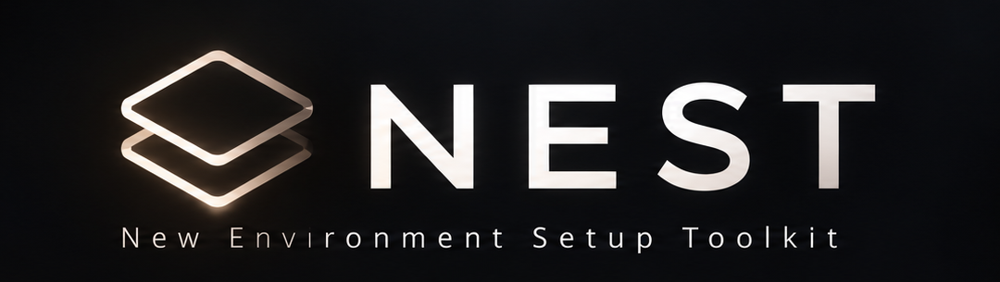

  

# Changelog

Every release of NEST, newest first. Each one starts with a sentence and a **For your workspace**
section in plain words: what it means if you already built a workspace with an earlier release.
`/nest-update` in your workspace reads that section to you.

| Release | Date | In short |
|---|---|---|
| [1.0.0](#100---2026-11-22) | 2026-11-22 | The first release: an interview that builds your own Claude Code workspace, and a way to keep it up to date afterwards. |

Format: [Keep a Changelog](https://keepachangelog.com/en/1.1.0/) · Versions: [Semantic Versioning](https://semver.org/) · How a release is made: [docs/project/releasing.md](docs/project/releasing.md)

## [Unreleased]

### 🏠 For your workspace

- **Undo is safer.** `/nest-update undo` now tells you first which update it puts back and
  which files that concerns. It always means the last update: asking twice no longer reaches
  back to an earlier one.
- **A typing mistake in `nest.json` no longer costs you your settings.** The update stops and
  names the line instead of starting over with an empty file.
- An update you brought over in parts no longer shows you changes you already have.
- When your workspace could not look for a new release (no internet), it tries again the next
  day instead of a week later.
- When NEST changes an example that something of yours was made from, such as your wiki
  settings, the update now tells you.
- **The wiki check is stricter, and right.** A link to a folder that no longer exists used to
  pass when a note with the same name lived somewhere else. The first check after this update
  may show a few broken links: they were broken all along.
- **New notes keep their name in every language.** A title in Greek, Arabic, Japanese or
  Cyrillic gave a note without a name; ß, ø and ł were lost. Existing notes do not change.
- **The wiki backup protects you from three mistakes:** it stops when a note holds what looks
  like a real key, when the wiki folder is suddenly empty, and when the backup folder belongs
  to another wiki (two workspaces with the same folder name). It says what to do in each case.
  After moving your workspace, run the backup's `init` once with `--rebind`.
- By hand, once, in Obsidian: open the settings of Meta Bind and add your inbox, your raw
  sources folder and your archive to "Excluded folders", so a button inside text that came
  from outside cannot run anything. `/nest-update` shows the exact names.
- A blueprint page in a workspace without The Council no longer tells you to "put it to the
  council", and its summary shows the assumption the plan really rests on.
- The first time you read a web page into your references, the wiki check no longer warns
  about its own log page.
- **Mail and calendar through Microsoft:** "any new mail?" no longer fails on some mailboxes,
  and when there is no internet or a sign-in expired you get one plain sentence with the
  command to type, not a wall of code.
- Before your assistant moves or cancels a meeting you organise, it now tells you that the
  people in it get a message.
- The Council and The Architects could stop halfway to ask permission for their own scoring
  and saving scripts. If that bothers you, ask your assistant to add the allow rules for
  `council_score.py`, `idea_page.py` and `wiki.py` to your settings; a new workspace gets them
  from the setup.

### ✨ Added

- `wiki_backup.py`: refuses a git directory that belongs to another wiki (`init --rebind`
  after a move), `init --set-remote`, `push --allow-empty`, a secret scan before each commit
  (`--no-scan`) and a warning for a folder in the wiki that is a git repository itself.
- `skills_catalog.py --installed`: fails on a leftover `customise:` or `<fill in:` marker in
  a built workspace.
- Meta Bind leaves the folders with raw outside text alone, and the ingest and inbox skills
  make Meta Bind code blocks and Templater tags in outside text inert.
- `kit/wiki/decisions-log.md`: the decisions log with its format block, which the session-end,
  inbox and career skills write to.

### 🔧 Changed

- `wiki_backup.py` leaves nested git repositories out of the backup and never waits for a
  password. `check_style.py --strict` exits 2 when the check could not run. `dashboard.base`
  uses `file.hasTag("query")`, which also works for a note without tags.
- `nest_update.py restore` has `--list` and `--dry-run`. The plan has a new status,
  `reference`, for a changed example file without a fixed place in a workspace.
- The idea skill no longer carries `allowed-tools`: that grant ends at the user's next
  message, before the scoring and saving scripts run. The setup writes allow rules instead.
- `kit/github/gitignore.template` ignores `.mcp.json` and `mail-folders.md`.
  `kit/claude/rules/writing.md` also loads for the README and `docs/`.
- `calendar update` takes `--end` on its own. The tool map has a "Sign in again" line and a
  row for `organize status`; the deny rule for the token folder is a placeholder per system.

### 🐛 Fixed

- `idea_page.py` took the first list item under "Assumptions and risks" as the load-bearing
  assumption, also when the blueprint names it in a sentence above the list; and it pointed
  at The Council in a workspace that only has The Architects.
- `wiki.py lint` warned that a sourced section's own ingest log and index have no sources.
- The research skill installed its job profile and device inventory for everyone; both are
  now a choice. The skill builder adds a new skill to the list in `CLAUDE.md` too.
- The README's download link pointed at the newest state of the main branch, while the
  workspace is stamped with the release in `SETUP.md`. It points at the latest release now.
- `wiki.py lint` accepted a link whose folder does not exist when a file of the same name
  lived elsewhere. It also stopped on an `author` written as a list and on `---` inside a
  value, and counted links inside comments, tilde fences and double-backtick code. Notes made
  from the kit templates, and Home, now pass the lint.
- `wiki.py lint --fix` broke table rows by writing an unescaped `|`; `reindex` threw away intro
  text that mentioned the index marker. A section's own `index.md` keeps the top-level status
  words when the section has its own list, so saving an idea no longer ends in a lint error.
- `slug.js` gave an empty file name for titles in a non-Latin script.
- `council_score.py` took the score and verdict of a judge whose criteria it could not check,
  and crashed on a negative or non-finite score.
- `idea_page.py`: status words without a section list, a heading inside a desk report that
  cut the page short, ticks lost after a renamed heading, pages written with mode 0600, titles
  YAML misreads, a malformed `verdict.json`.
- `check_style.py` missed entries in scripts without spaces between words and read `[sic]` as
  a section; `skills_catalog.py --check` said "ok" for a folder that does not exist.
- Template titles with a backslash and source URLs with a colon broke the frontmatter.
- `nest_update.py restore --force` after a `restore` put back an older update and wrote over
  the user's own changes. It now puts back only the files the first `restore` left alone.
- `restore` took an older update when the last one changed no files. An update that only
  declined parts or set the version now has its own history folder.
- `restore` that failed halfway (a read-only file, a file open in another program) could not be
  run again and overwrote the copies in `undone/`. It now reports the file, keeps the first
  copy, and picks up where it stopped.
- A `nest.json` that is not valid JSON was read as empty, after which `stamp` wrote over every
  other setting in it. A byte order mark at the start of the file is read correctly.
- `diff` always started at the workspace's version, also for a file that was already brought
  over. The stamp now records per file which release it came from.
- A deleted pre-commit hook came back without its executable bit, so git skipped it. `apply
  <path>` now brings back a deleted copy file and keeps the mode.
- The two-second limit of the update check at session start did not hold when git's helper
  process kept running (seen on macOS as a leftover process, expected on Windows as a long
  wait). The whole process group is stopped now.
- A workspace built from a version newer than the newest release got "up to date" from
  `check` and an error from `plan`. Both now say it is ahead.
- `graph.py` printed a Python traceback when the network, a date, a time zone or a file
  failed. Every command now prints one JSON line, and the short names for mails (m1, m2) stay
  true when two commands run at the same time.
- `graph.py mail list --unread` combined a filter and a sort order in a way Microsoft Graph
  documents as an error (`InefficientFilter`).
- The token cache of the Microsoft route was readable by other users for a moment while it
  was written. The README of that route no longer says the token cannot reach other people:
  answering an invitation and cancelling a meeting do.
- The mail, calendar and organizer skills pointed at a sign-in command the tool map did not
  have; the light Council formats lacked the `Assumptions` line the run files refer to; the
  session-end skill named a field its template does not have.
- Smaller: a missing `git` is named as such, a file of the other team size is no longer
  offered as new, a path spelled with other capitals in `backup` no longer blocks `mark`, an
  undo leaves no empty folders, and the fetched copy of a release follows a changed `source`.

---

## [1.0.0] - 2026-11-22

> **In short:** The first release: an interview that builds your own Claude Code workspace, and a way to keep it up to date afterwards.

### 🏠 For your workspace

- This is the first release, so there is nothing to bring over.
- From now on your workspace tells you when a newer release is out. `/nest-update` then shows
  what is new in plain words and changes only the parts you pick.

### ✨ Added

- **The setup prompt.** `SETUP.md`: a machine check, an interview in six blocks, a table that
  says where every answer lands, build steps with a check each, a final test round and a wrap-up
  with first tasks. It keeps its progress in a state file, so you can stop and continue in a
  later session.
- **Skills.** Wiki inbox, ingest, query and maintenance, Obsidian Markdown and Bases, idea (The
  Council), blueprint (The Architects), career, study inbox, research, session end, writing
  style, release, calendar, mail, mail organizer, morning briefing and a skill builder. You
  choose them one by one.
- **Agents.** The Council and The Architects in a full and a light size, a researcher and a
  read-only security reviewer.
- **Guards.** A secret scan before and after every write, a session-start line, a pre-commit
  scan, a guard that keeps the read-only reviewer read-only, and a guard that keeps the blind
  seats of the two teams inside their own run file.
- **Session guards.** Your own messages are kept word for word across a compaction, the
  assistant is told when a second session is open in the same folder, recorded lessons are shown
  when they apply, and an approved plan can be copied into the wiki inbox.
- **Updates.** `nest.json` records which release a workspace was built from. The `nest-update`
  skill and `nest_update.py` bring over a newer release: untouched files are replaced, adapted
  files are merged with your changes kept, every file is backed up first, and one command puts
  everything back.
- **The wiki kit.** Templates, Bases views, a Home page, base CSS with colour tokens, Obsidian
  settings and a plugin guide.
- **Integrations.** A decision guide per app category, a tool map, permission rules and a
  Microsoft Graph route for mail and calendar that cannot send mail.
- **GitHub kit.** A README template, a gitignore, a pre-commit hook and workflows for a
  workspace repo, plus a separate backup for the wiki.
- **Scripts with tests.** Wiki lint, reindex, stats and log, the skills catalogue, Council
  scoring, the idea page builder, the writing-style check and the wiki backup, tested on macOS,
  Linux and Windows.

[Unreleased]: https://github.com/nickyjacobs/NEST/compare/v1.0.0...HEAD
[1.0.0]: https://github.com/nickyjacobs/NEST/releases/tag/v1.0.0
