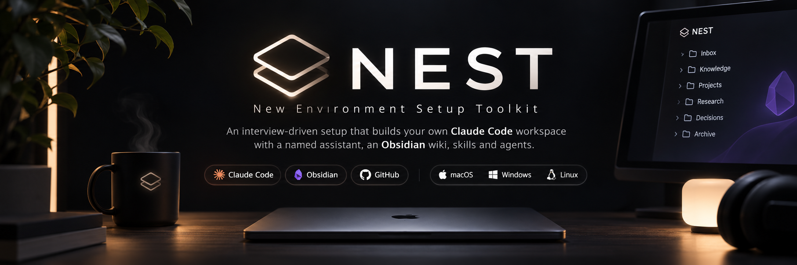
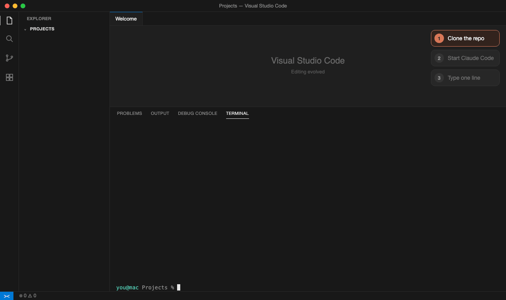
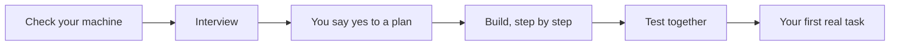
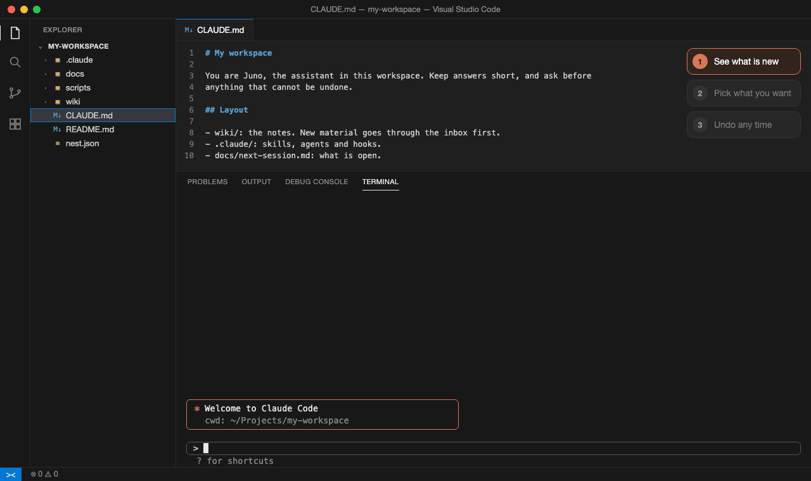

<p align="center">
  
</p>

<p align="center">
  <a href="https://github.com/nickyjacobs/NEST/releases/latest"></a>
  <a href="https://code.claude.com/docs/en/overview"></a>
  <a href="https://obsidian.md"></a>
  
  
  
  <a href="https://github.com/nickyjacobs/NEST/actions/workflows/ci.yml"></a>
  <a href="LICENSE"></a>
</p>

<p align="center">
  <b>One prompt that interviews you and builds a Claude Code workspace around your life and your apps.</b><br>
  You answer, it proposes, and nothing is built without your yes.
</p>

<p align="center">
  <a href="#quick-start">Quick start</a> ·
  <a href="#what-you-get">What you get</a> ·
  <a href="#how-it-works">How it works</a> ·
  <a href="#your-data">Your data</a> ·
  <a href="#staying-up-to-date">Updates</a> ·
  <a href="#faq">FAQ</a> ·
  <a href="ROADMAP.md">Roadmap</a> ·
  <a href="docs/README.md">Docs</a>
</p>

<p align="center">
  
</p>

## Quick start

You need [Claude Code](https://code.claude.com/docs/en/overview) (a paid Claude plan or API
access) and [Obsidian](https://obsidian.md). NEST checks the rest and tells you what to
install for your system.

```bash
git clone https://github.com/nickyjacobs/NEST.git
cd NEST
claude
```

Then type:

```
Read SETUP.md and follow it.
```

That starts the first of about five sessions of 30 to 60 minutes. Stop whenever you like: the
setup remembers where you were and tells you the line that starts the next session.

<details>
<summary>No git yet?</summary>

Open the [latest release](https://github.com/nickyjacobs/NEST/releases/latest), download
"Source code (zip)" under Assets, unpack it, open a terminal in that folder and run `claude`. The setup helps you install git along the way.

</details>

## What you get

A good workspace normally takes weeks to grow, and copying someone else's gives you their
folders and their habits. NEST starts from you: who you are, where you get stuck, which apps
you use. It builds only what fits, in your own language.

| | Part | What it does for you |
|---|---|---|
| 🧭 | **Your assistant** | It has a name, a tone and a short profile of you, so every session starts from context instead of from zero |
| 📚 | **A wiki that keeps itself tidy** | An Obsidian vault in your structure. You drop raw notes; the assistant files, links and indexes them |
| 🧩 | **Skills you choose, one by one** | Routines for your notes, research, studying, writing, mail, calendar and your morning. Take what you need |
| 🏛️ | **Two agent teams, if you want them** | The Council judges an idea with a jury. The Architects turn a rough idea into a blueprint |
| 🛡️ | **Guards that always run** | A secret is stopped before it lands in a file, and your own words survive a long conversation |
| 🔄 | **Updates you control** | When NEST improves, your workspace tells you. You pick what comes in; your own changes stay |
| 🐙 | **GitHub, if you want it** | A private repo for the workspace and a separate backup for your wiki |

Every part is a separate choice. A part you do not need is never created.

## How it works

1. **Check.** NEST looks at your machine and gives you the exact install command for anything
   that is missing.
2. **Interview.** Six short rounds: who you are, where you get stuck, your wiki, your skills and
   apps, GitHub, and the names last. "Don't know yet" is always a valid answer.
3. **Build.** Step by step, each with a check, and only after your yes.
4. **Grow.** You end with a map of what was built, a cheat sheet and a few first tasks that
   match what you said you struggle with.



More: [what to expect from the setup](docs/guide/what-to-expect.md).

## Your data

- **It stays with you.** Your answers, your wiki and your workspace live in a folder on your
  machine. NEST has no server and collects nothing.
- **No passwords.** NEST never asks for one. Mail and calendar sign in through their own login
  flow, and your assistant can draft a reply but never send one.
- **Private stays private.** Personal context goes in a file git ignores, and a scan runs
  before every write and every commit.

Details: [SECURITY.md](SECURITY.md).

## Staying up to date

Your workspace is yours once it is built, and NEST keeps improving. When a newer release is out,
the first line of a session says so. You decide:

```
/nest-update
```

<p align="center">
  
</p>

- **Untouched files** are replaced.
- **Files adapted for you** are merged, with your changes kept, after you see the result.
- **Your own files** (your `CLAUDE.md`, your wiki, your own skills) are never part of an update.

Everything is backed up first, and `/nest-update undo` puts it back.
More: [keeping your workspace up to date](docs/guide/updating.md) · [CHANGELOG](CHANGELOG.md).

## FAQ

<details>
<summary><b>What does it cost?</b></summary>

NEST is free and open source. It runs inside Claude Code, which needs a paid Claude plan or API
access; the free Claude plan does not include it.

</details>

<details>
<summary><b>Do I need to be technical?</b></summary>

No. The setup asks your level first and explains at that level. You never edit a config file
by hand.

</details>

<details>
<summary><b>Can I use my own language?</b></summary>

Yes. The first question is which language you want. Your wiki, your assistant and your skills
are written in it.

</details>

<details>
<summary><b>I already have an Obsidian vault. Can I keep it?</b></summary>

Yes. The setup notes where your notes are and makes bringing them in one of your first tasks.
Your own notes are never rewritten.

</details>

<details>
<summary><b>Does it work on Windows and Linux?</b></summary>

The scripts are tested on macOS, Windows and Linux on every change. A complete setup by a person
has so far been done on macOS only, so an issue about what you hit is very welcome.

</details>

<details>
<summary><b>What is NEST not?</b></summary>

Not a voice assistant or an always-on service: everything runs in your own Claude Code
sessions. Not a template you copy: the files in `kit/` are reference material the setup adapts
to your answers. Not a cloud service: nothing leaves your machine unless you push it to your own
private repo.

</details>

<details>
<summary><b>How do I remove it?</b></summary>

Delete the workspace folder. Everything NEST built lives inside it.

</details>

More questions: [docs/guide/faq.md](docs/guide/faq.md).

## Roadmap

Three things the next releases work on: your assistant from your phone, a board for your
projects and ideas on your Home page, and a place in your own workspace for what your
assistant remembers. What comes after, and what NEST will not become:
[ROADMAP.md](ROADMAP.md).

## Documentation

| Page | What it covers |
|---|---|
| [What to expect](docs/guide/what-to-expect.md) | The sessions, the interview rounds, stopping and continuing |
| [Updating](docs/guide/updating.md) | How `/nest-update` works, what is never touched, undo |
| [FAQ](docs/guide/faq.md) | Cost, privacy, languages, removing it |
| [nest.json](docs/reference/nest-json.md) | Every setting of a workspace |
| [The kit](kit/README.md) | The reference files the setup adapts |
| [Changelog](CHANGELOG.md) | Every release, with what it means for your workspace |
| [Roadmap](ROADMAP.md) | What is coming, and what NEST will not become |
| [Contributing](CONTRIBUTING.md) | Branches, commits, pull requests, releases |

## Feedback

NEST is new. If the setup confused you, asked something odd or broke on your system, please
[open an issue](https://github.com/nickyjacobs/NEST/issues): that is exactly what makes it
better. Questions, ideas for skills and what you built with it belong in
[Discussions](https://github.com/nickyjacobs/NEST/discussions).

## Credits

- The wiki follows Andrej Karpathy's
  [LLM wiki pattern](https://gist.github.com/karpathy/442a6bf555914893e9891c11519de94f): you
  supply, the model compiles.
- The Obsidian Markdown and Bases skills come from
  [obsidianmd/obsidian-skills](https://github.com/obsidianmd/obsidian-skills) (MIT).

## License

[MIT](LICENSE) © Nicky Jacobs
