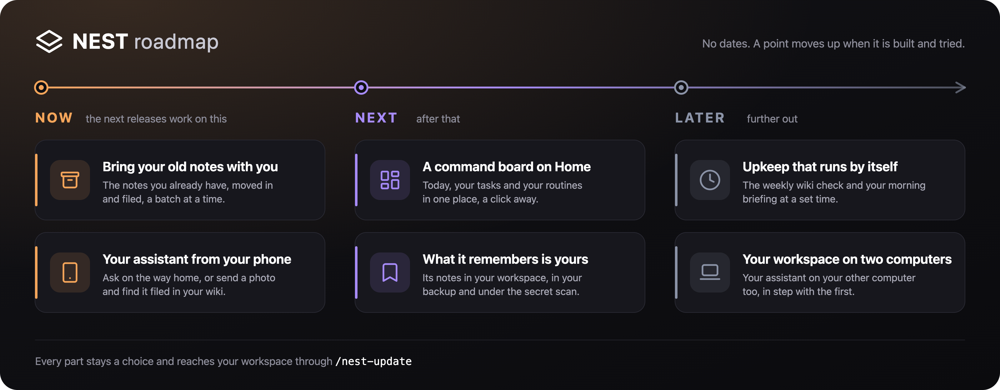

# Roadmap

Where NEST is going, seen from your chair: what you will notice, not which file changes. No
dates. A point moves up when it is built and tried, and into the [changelog](CHANGELOG.md) when
it ships. Every new part stays a choice, and reaches a workspace you already have through
`/nest-update`.

  

## 🟠 Now

What the next releases work on.

- 📦 **Bring your old notes with you.** The setup already finds the notes you have. This is the
  step after it: your assistant moves them in a batch at a time, files them where they belong,
  and leaves the originals where they are until you say otherwise.
- 📱 **Your assistant from your phone.** Ask a question on the way home, or send a photo of a
  whiteboard and find it filed in your wiki. It uses Claude Code's own remote control, so there
  is still no server and no bot: your computer does the work, your phone is the window.

## 🟣 Next

- 🎛️ **A command board on Home.** Your day, your tasks and your routines in one place on your
  start page: what is on today, what is open, and the things you ask your assistant most, a
  click away instead of a command to remember.
- 🔖 **What your assistant remembers is yours.** Claude Code keeps notes of its own about how you
  work, outside your workspace. NEST gives them a place you can see: inside your workspace, in
  your backup, and under the same secret scan as everything else.

## ⚪ Later

- ⏰ **Upkeep that runs by itself.** The weekly check of your wiki and your morning briefing at a
  set time, without you asking.
- 💻 **Your workspace on two computers.** Today your notes can be on every device and your
  assistant lives on one computer. This puts the assistant on your other computer too, in step
  with the first.

## Have a say

This list comes from the first people who ran the setup, from our own trial runs, and from what
people ask for in projects like this one. Your experience counts for more. Tell us what would
help you in [Discussions](https://github.com/nickyjacobs/NEST/discussions), or open an
[issue](https://github.com/nickyjacobs/NEST/issues) when something broke.

The technical list of what is not built or not tested yet, with the reasons, is the
[backlog](docs/project/backlog.md).
