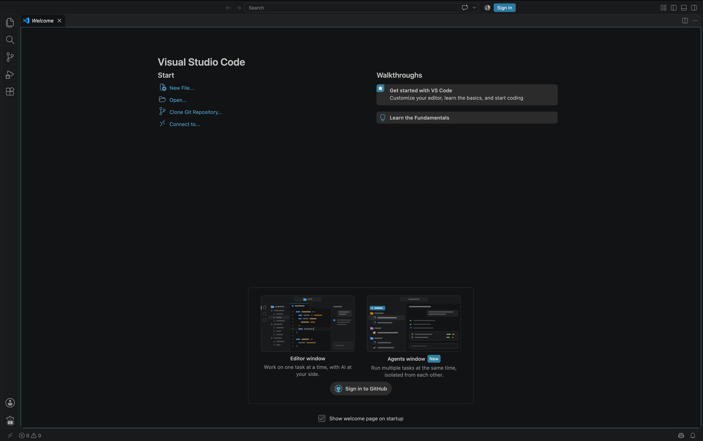
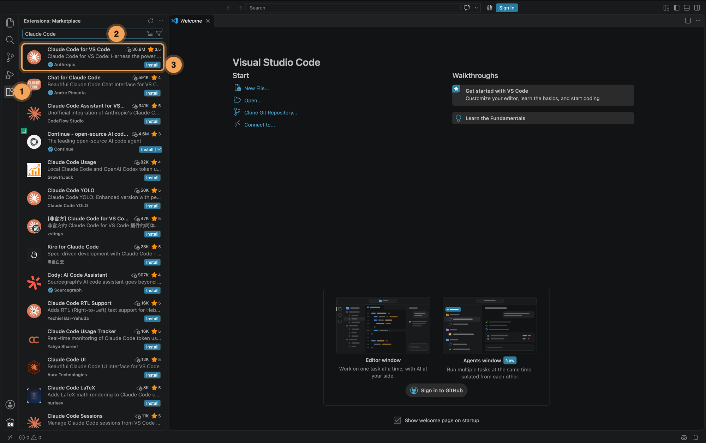
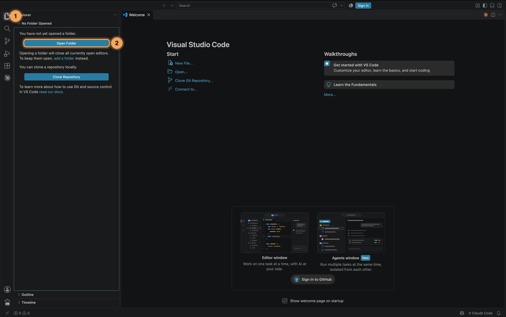
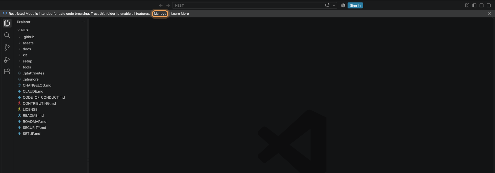
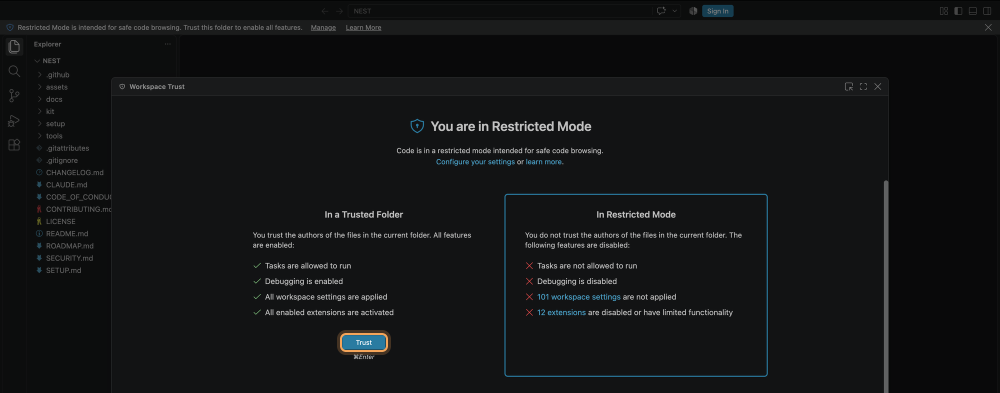
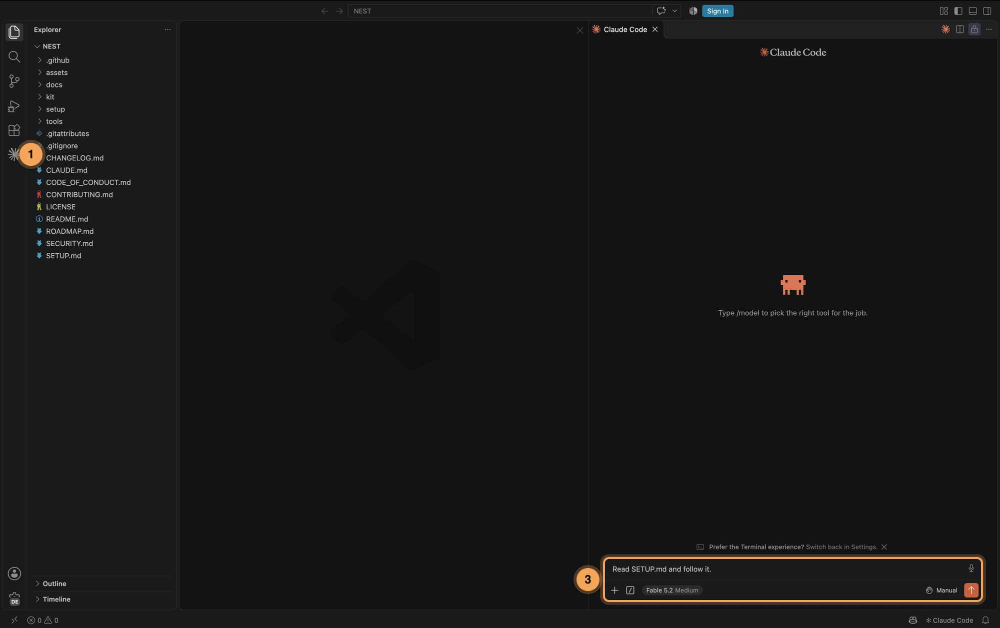
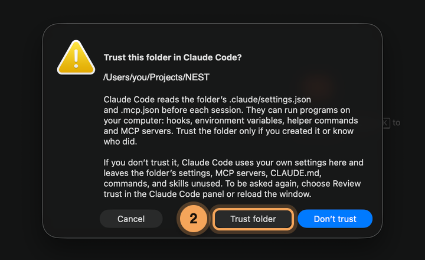

# Getting started, step by step

← [Docs](../README.md)

**On this page:** [What you need](#what-you-need) · [1. VS Code](#1-install-vs-code) · [2. Claude Code](#2-add-claude-code) · [3. Obsidian](#3-install-obsidian) · [4. Download NEST](#4-download-nest) · [5. Open the folder](#5-open-the-folder) · [6. Start](#6-start-the-setup) · [Coming back](#coming-back-later)

For people who have never opened a terminal. You install three free programs, download one
folder, and type one sentence. After that the setup asks you questions and builds your
workspace; you mostly click.

If you already use Claude Code in a terminal, the [quick start](../../README.md#quick-start) is
three commands.

## What you need

- A computer with Windows, macOS or Linux.
- A paid Claude plan (Pro or higher). The free plan does not include Claude Code.
- About fifteen minutes for the steps on this page. The setup itself takes about an hour and a
  half of questions and an hour in which it builds, spread over as many days as you like.

You do not need git, a terminal or any knowledge of code. The setup installs what else it
needs, after asking.

## 1. Install VS Code

VS Code is a free program from Microsoft for working in a folder of files. You will use two
parts of it: the list of your files on the left, and a chat with Claude on the right.

1. Go to [code.visualstudio.com](https://code.visualstudio.com) and download it for your system.
2. Install it the way you install any program, and open it.

<p align="center">
  
</p>

## 2. Add Claude Code

Claude Code is the part that lets Claude read and write files in a folder you choose. In VS
Code it is an extension: an add-on you install from inside the program.

1. In the bar of icons on the left, click the one made of four squares (**Extensions**).
2. Type `Claude Code` in the search box.
3. Choose **Claude Code for VS Code** by **Anthropic**, the one with the blue check mark, and
   click **Install**. The list below it holds look-alikes made by others: skip those.

<p align="center">
  
</p>

A new icon appears in the bar on the left: a small orange spark. The first time you click it,
it asks you to **sign in**. That opens your browser, where you log in to your Claude account
and come back.

## 3. Install Obsidian

Obsidian is a free program that shows your notes. NEST builds your notes as plain files, and
Obsidian is the window you look at them through.

1. Go to [obsidian.md](https://obsidian.md), download it and install it.
2. You do not need to open it or make anything in it yet. The setup tells you when.

## 4. Download NEST

1. Open the [latest release of NEST](https://github.com/nickyjacobs/NEST/releases/latest).
2. Under **Assets**, click **Source code (zip)**.
3. Unpack the zip file (double-click it; on Windows choose *Extract all*).
4. Move the unpacked folder to a place you will find again, such as a folder `Projects` in your
   home folder. Not into iCloud Drive, OneDrive, Dropbox or Google Drive: those services and
   NEST get in each other's way.

## 5. Open the folder

1. In VS Code, click the top icon in the bar on the left (**Explorer**), then **Open Folder**.
   The menu **File**, **Open Folder** does the same.
2. Pick the NEST folder you just unpacked, and confirm.

<p align="center">
  
</p>

VS Code wants to know whether you trust the files in this folder. It asks in one of two ways:

- A window with the question whether you trust the authors: choose **Yes, I trust the
  authors**.
- Or a blue bar along the top that says **Restricted Mode**. Then the spark icon is missing,
  because Claude Code is switched off in that mode. Click **Manage** in that bar, then
  **Trust**.

<p align="center">
  
</p>

<p align="center">
  
</p>

You now see the files of NEST in the list on the left. You do not have to open any of them.

## 6. Start the setup

1. Click the spark icon in the bar on the left. The Claude Code panel opens.
2. Claude Code asks, once, whether you trust this folder. Choose **Trust folder**. Look
   before you click: the button that lights up is the other one, **Don't trust**.
3. Type this sentence in the box at the bottom of the panel, and press Enter:

```
Read SETUP.md and follow it.
```

The numbers in the two pictures are the numbers of these steps.

<p align="center">
  
</p>

<p align="center">
  
</p>

The first thing you get is a question: which language do you want to use. From there the setup
leads. It checks your computer, asks about you and what gets in your way, and then builds.

Good to know while it runs:

- Most questions are a choice you click. A few ask for your own words.
- Claude Code itself may ask "may I do this?" before it writes a file or runs a command. The
  setup tells you what those questions are for, and offers a way to have fewer of them while it
  builds.
- You can stop at any moment. Nothing is lost.

The pictures on this page were made on a Mac. On Windows the window looks a little different;
the steps and the names of the buttons are the same.

## Coming back later

The setup takes several sittings. To go on where you were:

1. Open VS Code. It usually opens the folder you had open last; if not, **File**, **Open
   Folder**, and pick it again.
2. Click the spark icon. In the list that opens on the left, choose **New session**, and type
   the same sentence:

```
Read SETUP.md and follow it.
```

Halfway through, the setup makes a new folder: your own workspace, with the name you chose. It
tells you when, gives you the folder to open with **File**, **Open Folder**, and gives you the
sentence to type there. From then on that folder is the one you open, also after the setup is
done: it is where your assistant lives.

More: [what the setup asks and how long it takes](what-to-expect.md), [your notes on a phone
or a second computer](devices.md), [common questions](faq.md).
