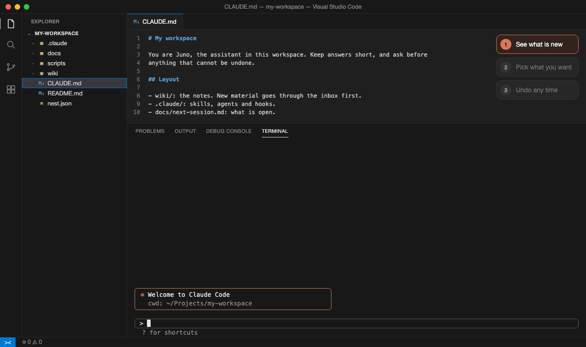
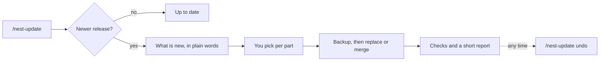

<sub>[Docs](../README.md) · [What to expect](../guide/what-to-expect.md) · [Updating](../guide/updating.md) · [FAQ](../guide/faq.md) · [nest.json](../reference/nest-json.md) · [Hooks](../reference/hooks-notes.md) · [Releasing](../project/releasing.md) · [Backlog](../project/backlog.md)</sub>

# Keeping your workspace up to date

Your workspace is yours once it is built. NEST keeps getting fixes and new parts. This is how
they reach you, and why they cannot break what you made.

**On this page:** [How you hear about it](#how-you-hear-about-it) · [What an update looks like](#what-an-update-looks-like) · [What is never touched](#what-is-never-touched) · [Undo](#undo) · [Turning the reminder off](#turning-the-reminder-off) · [Under the hood](#under-the-hood)

## How you hear about it

When a newer release is out, the first line of a session says so:

```
Workspace: wiki inbox 3 notes, NEST 1.2.0 is available (this workspace is on 1.1.0)
```

Your workspace looks online at most once a week. Nothing is ever installed on its own.

## What an update looks like

Type `/nest-update`, or just ask "is there a NEST update?".

<p align="center">
  
</p>

1. **You see what is new, in plain words.** Not which files changed, but what changes for you.
2. **You pick per part.** All, none, or by number. "Later" keeps a part on offer; "no" means it
   is not offered again unless NEST changes it once more.
3. **Each part is handled the safe way for what it is:**

| The part is... | What happens |
|---|---|
| Something you never touched | Replaced, and the old version is kept |
| Something adapted for you, or changed by you | Merged with your changes kept. You see the result and say yes before it is saved |
| New | Offered. A new skill is written for you the way the setup would |
| Something with the same name as a file of your own | Yours stays. You are asked what you want |
| Dropped by NEST | You choose: keep it, or take it out (the last version is kept) |
| An example that something of yours was made from, such as your wiki settings | You hear what changed in the example and whether yours needs it |

4. **Checks run**, and you get a short report with what was updated, added and skipped.



## What is never touched

Your `CLAUDE.md` and `CLAUDE.local.md`, the pages of your wiki, your list of sensitive terms,
your lessons, your `docs/` (only the generated list of skills in it is refreshed), and every
skill, agent or rule you made yourself. They are not part
of NEST's kit, so an update does not know them.

## Undo

Every file is backed up before it changes, in `.claude/.history/` inside your workspace.

```
/nest-update undo
```

puts back what the last update changed and takes away what it added. You are told first which
update it is and which files it concerns, and you say yes before anything moves. A file you
changed yourself after the update is left alone, and you are told which one.

Undo always means the last update, also when you brought it over in parts (some things first,
the rest a little later): all parts go back together. Asking twice does not reach further back: an earlier update
is only put back when you ask for that one by name.

## Turning the reminder off

In `nest.json`, inside `nest`, set `"update_check": false`. `/nest-update` keeps working when
you ask for it. To skip one release only, say so during the update.

## Under the hood

`nest.json` holds a stamp: the release your workspace was built from, and for each installed
file which kit file it came from and what that file looked like. `/nest-update` fetches the
release you are on and the newest one, both by their tag, and compares them file by file with
your workspace. A file that still equals its kit original can be replaced; anything else is a
merge. The exact part is done by `scripts/nest_update.py`, which has no dependencies beyond git.
Settings: [reference/nest-json.md](../reference/nest-json.md).
