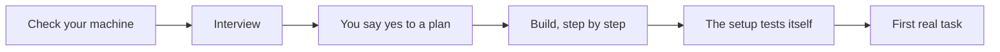

<sub>[Docs](../README.md) · [What to expect](../guide/what-to-expect.md) · [Updating](../guide/updating.md) · [FAQ](../guide/faq.md) · [nest.json](../reference/nest-json.md) · [Hooks](../reference/hooks-notes.md) · [Releasing](../project/releasing.md) · [Backlog](../project/backlog.md)</sub>

# What to expect from the setup

NEST is a conversation, not an installer. Claude Code reads `SETUP.md`, asks you questions,
proposes a workspace and builds it with you. Nothing is built without your yes.

**On this page:** [Before you start](#before-you-start) · [The four sessions](#the-four-sessions) · [The interview](#the-interview) · [What you end up with](#what-you-end-up-with) · [Stopping and continuing](#stopping-and-continuing)

## Before you start

| You need | Why | If you do not have it |
|---|---|---|
| [Claude Code](https://code.claude.com/docs/en/overview) 2.1.295 or later | It runs the setup and your workspace | Install it first; NEST cannot do that for you |
| [Obsidian](https://obsidian.md) | It opens your wiki | Install it first, or postpone it: the setup builds the wiki and you open it in Obsidian later |
| git and [uv](https://docs.astral.sh/uv/) | History, backups and the scripts | The setup checks and gives you the install command for your system |
| The GitHub CLI (optional) | A private repo and a backup for your wiki | Skip it; everything works locally |

The scripts are tested on macOS, Windows and Linux, and a complete setup has been run on macOS
and Linux. You do not need to know how to code.

## The four sessions

The setup suggests four sessions. The interview takes about an hour and a half, spread over the
first two; the build about an hour, in which you mostly watch and say yes. You start each
session with the same line, and you can stop between any two steps.

| Session | What happens | It ends with |
|---|---|---|
| 1 | The machine check, then who you are and where you get stuck | A recap of you and what bothers you |
| 2 | Your wiki, your skills and apps, GitHub, the names | The setup creates your workspace folder; you open it |
| 3 | The build: your assistant, the rules, the guards, the wiki, the skills | A workspace that is built |
| 4 | Tests the setup runs itself, GitHub, the wrap-up | Your first real task |

Connecting mail or a calendar adds one session before the last, because a new connection only
loads when a session starts.

Most questions are a choice you click. A handful ask for your own words: who you are, what gets
in your way, what would make this a good year.



## The interview

Six short rounds. Closed questions come with a recommendation, and "don't know yet" is always a
valid answer: it becomes an open question you can settle later.

| Round | About | It decides |
|---|---|---|
| A | Who you are, your week, your apps | The profile your assistant starts from |
| B | Where you get stuck | Which parts NEST recommends at all |
| C | Your wiki | The sections, the language, the look |
| D | Skills, agents, integrations, guards | What your assistant can do, and how independently |
| E | GitHub | Backups, a private repo, protections |
| F | Names | What the folder and your assistant are called, asked last on purpose |

## What you end up with

A folder you open with Claude Code every day: an assistant that knows you, a wiki that files and
indexes itself, the skills you picked, guards that scan for secrets when a file is written and, with the pre-commit check, before a
commit, and
a cheat sheet for daily use. The [README](../../README.md#what-you-get) has the full list.

## Stopping and continuing

Stop whenever you want. The setup writes your answers and its progress to files as it goes, so
the next session picks up where you left off with the same line:

```
Read SETUP.md and follow it.
```

After the workspace folder exists, the setup tells you the new line to use from inside it.
