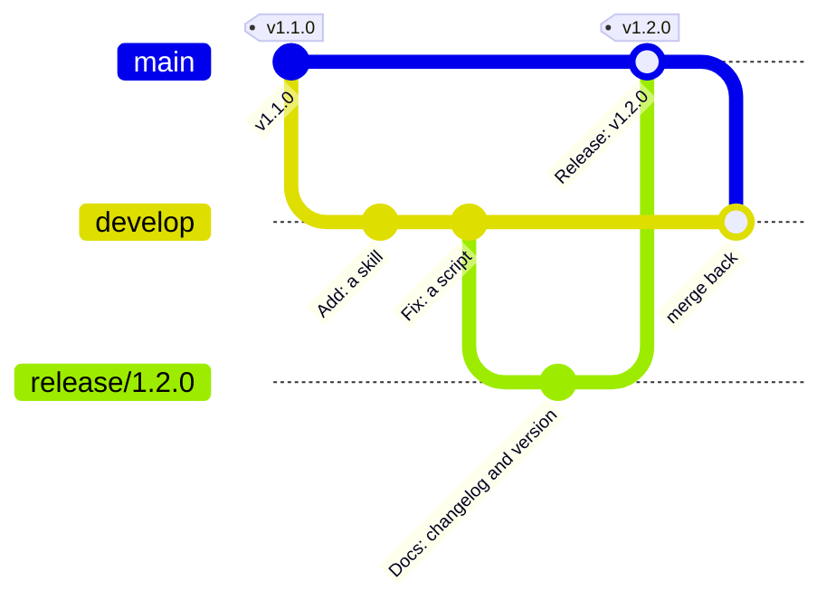

<sub>[Docs](../README.md) · [What to expect](../guide/what-to-expect.md) · [Updating](../guide/updating.md) · [FAQ](../guide/faq.md) · [nest.json](../reference/nest-json.md) · [Hooks](../reference/hooks-notes.md) · [Releasing](../project/releasing.md) · [Backlog](../project/backlog.md)</sub>

# Releasing NEST

One template for the changelog, the tag and the GitHub release, and the steps that produce them.
Branch, commit and pull request conventions are in [CONTRIBUTING.md](../../CONTRIBUTING.md).

**On this page:** [Version numbers](#version-numbers) · [The changelog template](#the-changelog-template) · [The GitHub release](#the-github-release) · [Steps](#steps) · [What a release reaches](#what-a-release-reaches)



## Version numbers

NEST uses [Semantic Versioning](https://semver.org/), read from the point of view of someone
who already has a workspace:

| Part | Goes up when | Example |
|---|---|---|
| Patch, `1.1.x` | Fixes only. Nothing new to choose. | A script bug, a typo in a skill |
| Minor, `1.x.0` | Something new, and everything that exists keeps working | A new skill, a new guard, a new setup question |
| Major, `x.0.0` | An existing workspace has to change to keep working | A script that needs a new config shape |

The version is written in four places that must agree: the README badge, the `SETUP.md` header,
the STATE template in `SETUP.md`, and the newest heading in `CHANGELOG.md`.
`tools/release_check.py` checks that on every push.

## The changelog template

```markdown
| Release | Date | In short |
|---|---|---|
| [1.2.0](#120---2027-03-01) | 2027-03-01 | One sentence a newcomer understands. |
| [1.1.0](#110---2026-11-22) | 2026-11-22 | ... |

## [Unreleased]

### 🏠 For your workspace

- ...

### ✨ Added

- ...

---

## [1.2.0] - 2027-03-01

> **In short:** One sentence a newcomer understands.

### 🏠 For your workspace

- What this release means for someone who already has a workspace, in plain words.
- One bullet per thing they will notice or can choose.

### ✨ Added

- ...

### 🔧 Changed

- ...

### 🐛 Fixed

- ...

### 🗑️ Removed

- ...

### 🔒 Security

- ...

---

## [1.1.0] - 2026-11-22

...

[Unreleased]: https://github.com/nickyjacobs/NEST/compare/v1.2.0...HEAD
[1.2.0]: https://github.com/nickyjacobs/NEST/compare/v1.1.0...v1.2.0
[1.1.0]: https://github.com/nickyjacobs/NEST/compare/v1.0.0...v1.1.0
```

Rules:

- The table at the top has one row per release, newest first: the version linked to its
  heading, the date, and the "In short" sentence.
- A `---` line closes every block except the last one.
- `> **In short:**` and `### 🏠 For your workspace` come first in every release. Write them for
  a user who does not read code: say what changes for them, not which file changed. The
  `nest-update` skill reads this section to users, so it is the most-read text of a release.
  When a release changes nothing for existing workspaces, say so in one bullet.
- The other sections keep this order, each with its own icon: ✨ Added, 🔧 Changed, 🐛 Fixed,
  🗑️ Removed, 🔒 Security. Leave out the ones that are empty.
- One bullet per change, starting with what it is. Name files in backticks.
- A link line at the bottom for `Unreleased` and for every version.

## The GitHub release

Made by the `release` workflow from the changelog block, so it always looks the same:

| Part | Where it comes from |
|---|---|
| Title `NEST vX.Y.Z` | The tag |
| Banner | `assets/release-banner.png` at that tag |
| The "In short" line and the sections, with a divider between them | That version's block in `CHANGELOG.md` |
| Closing line: quick start, `/nest-update`, full changelog | Added by `tools/release_check.py --notes` |

Preview it before tagging: `uv run --script tools/release_check.py --notes <x.y.z>`.

## Steps

1. From `develop`: `git switch -c release/<x.y.z>`.
2. In `CHANGELOG.md`: rename `## [Unreleased]` to `## [<x.y.z>] - <today>`, add the
   `> **In short:**` line, add the row to the table at the top, put a new empty
   `## [Unreleased]` with a `---` above it, and update the link lines.
3. Set the version in the README badge (`NEST_v<x.y.z>` in the URL, and the alt text) and in
   `SETUP.md` (the header and `nest_version` in the STATE template).
   Move the examples one release up as well, so they never show the new release as something
   still to come: the example in `docs/reference/nest-json.md`, the session line in
   `docs/guide/updating.md`, the diagram and the template on this page, the overview in
   `kit/skills/nest-update/SKILL.md`, and `assets/quickstart-src/scene-update.html`. Render the
   GIFs again (`assets/quickstart-src/README.md`): the quick start shows the head of `SETUP.md`.
4. Check:
   ```bash
   uv run --script tools/release_check.py
   uv run --project kit/scripts pytest -q kit/scripts/tests
   ```
   and do a trial run of the setup when `SETUP.md` or a build step changed (`CLAUDE.md`
   describes how).
5. Commit as `Docs: changelog and version for <x.y.z>`, push, and open a pull request into
   `main` titled `Release: v<x.y.z>`.
6. Merge it with a merge commit. Then tag the merge commit and push the tag:
   ```bash
   git switch main && git pull
   git tag v<x.y.z> && git push origin v<x.y.z>
   ```
   The `release` workflow checks the tag against the changelog and publishes the GitHub
   release, titled `NEST v<x.y.z>`, with that version's changelog block as its text.
7. Merge `main` back into `develop` (a pull request titled `Update: merge v<x.y.z> back into
   develop`, merged with a merge commit).

A hotfix is the same from step 2, on a `hotfix/<short-name>` branch from `main`, with a patch
version.

## What a release reaches

Workspaces built from an earlier release look for new tags at most once a week and tell their
user when there is one. The `nest-update` skill then compares the two tags file by file. So a
tag is a promise: never move or delete one, and never change a release after it is out. A
mistake in a release is fixed by the next patch release.
